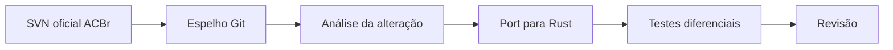

# ACBr Mirror & ACBr Rust

**Uma ponte entre o SVN do Projeto ACBr e um port experimental em Rust.**

Este repositório é uma iniciativa independente e **não oficial** da Kodexx. O [SVN do Projeto ACBr](https://svn.code.sf.net/p/acbr/code/trunk2) é a fonte de verdade para o código Pascal; os direitos dos componentes pertencem aos respectivos autores e colaboradores.

## Navegue pelo projeto

| Branch | Conteúdo | Como é atualizada |
| --- | --- | --- |
| [`main`](https://github.com/kodexx-pro/acbr/tree/main) | Apresentação e documentação do projeto. | Manualmente. |
| [`upstream/trunk2`](https://github.com/kodexx-pro/acbr/tree/upstream/trunk2) | Espelho do histórico e dos arquivos do `trunk2` oficial. | Automaticamente pela VPS, via `git-svn`. |
| [`rust`](https://github.com/kodexx-pro/acbr/tree/rust) | Código-fonte, testes e documentação do port experimental em Rust. | Por alterações de desenvolvimento, após verificação. |

As branches têm históricos independentes. O espelho cobre `trunk2`; não inclui automaticamente `tools` ou as outras branches e tags SVN. Não faça commits manuais nem force push em `upstream/trunk2`.

## Do SVN ao Rust



1. A VPS consulta o SVN oficial e converte as revisões relevantes em commits Git, preservando mensagens e metadados disponíveis. O rodapé `git-svn-id` identifica o caminho, UUID e número da revisão de origem.
2. O serviço publica os commits em `upstream/trunk2` sem reescrever seu histórico. Um bloqueio impede execuções simultâneas; falhas são registradas e a próxima execução tenta novamente.
3. Escolhemos uma funcionalidade delimitada, identificamos o arquivo, a revisão e os colaboradores da referência e implementamos o comportamento em Rust.
4. Testamos exemplos e casos de borda, inclusive comparando a execução Rust com a função Pascal correspondente quando o teste for viável. Divergências e limitações são documentadas.
5. Publicamos o código verificado na branch `rust`, com o aviso de autoria e a licença aplicável ao trecho portado.

**O espelhamento é automático. A análise, a portabilidade e a revisão ainda são manuais.** O fluxo de agentes descrito acima é a direção planejada, não um serviço já implantado. Uma revisão publicada no espelho não significa que ela já foi portada.

## Primeiro recorte em Rust

A crate [`acbr-dfe`](https://github.com/kodexx-pro/acbr/tree/rust/crates/acbr-dfe) contém `validar_codigo_uf`, portada de `ValidarCodigoUF` da unit `ACBrDFeUtil`. A implementação foi comparada com a função Pascal extraída da revisão SVN **r49417**, em 3.003 entradas, na VPS Linux ARM64.

A crate usa `no_std` e não possui dependências externas. Trata-se de uma prova de conceito: ainda não valida documentos fiscais completos e não foi homologada em outras plataformas ou dispositivos.

### Instalação

Adicione ao `Cargo.toml` do seu projeto:

```toml
[dependencies]
acbr-dfe = { git = "https://github.com/kodexx-pro/acbr.git", branch = "rust" }
```

```rust
use acbr_dfe::validar_codigo_uf;

assert!(validar_codigo_uf(42)); // Santa Catarina
assert!(!validar_codigo_uf(99));
```

Para um build reproduzível, substitua `branch` por `rev` com um SHA específico e mantenha o `Cargo.lock` do seu projeto. A branch `rust` está em desenvolvimento e pode mudar.

### Testes

```bash
git clone --single-branch --branch rust https://github.com/kodexx-pro/acbr.git acbr-rust
cd acbr-rust
cargo test --workspace
```

Para reproduzir a comparação com Pascal, instale Python 3 e Free Pascal e aponte para um clone do espelho que contenha o commit fixado no [`NOTICE.md`](https://github.com/kodexx-pro/acbr/blob/rust/NOTICE.md):

```bash
export ACBR_MIRROR_DIR=/caminho/para/o/clone-do-espelho
python3 scripts/verify_differential.py
```

O teste compila a **função extraída** do fonte Pascal, não a unit ACBr completa. A referência retorna `false` para o código `91` devido a um delimitador ausente em sua constante; o port reproduz esse comportamento. Isso não estabelece a regra fiscal correta. Veja a [documentação da branch Rust](https://github.com/kodexx-pro/acbr/tree/rust) para detalhes.

## Acompanhe o espelho

O temporizador aguarda cerca de cinco minutos após cada execução para iniciar a próxima. Na VPS:

```bash
systemctl --user status acbr-mirror-sync.timer
journalctl --user -u acbr-mirror-sync.service -n 50 --no-pager
```

O diretório `.git` do clone `git-svn` e sua configuração precisam ser preservados e incluídos no backup. Alterações no ACBr devem ser propostas pelos canais oficiais do projeto.

## Origem, autoria e licença

A licença e os avisos originais são preservados no espelho. O arquivo usado no primeiro port declara **LGPL 2.1 ou posterior**; a branch `rust` inclui a licença, os créditos e o cabeçalho original em [`NOTICE.md`](https://github.com/kodexx-pro/acbr/blob/rust/NOTICE.md). Outros componentes e suas dependências devem ser analisados individualmente. Informações oficiais: [fontes do ACBr](https://projetoacbr.com.br/fontes/).
