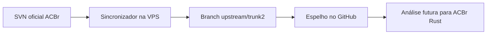

# ACBr Mirror

> Espelho **não oficial** do código-fonte do Projeto ACBr, mantido para facilitar a consulta do histórico em Git e apoiar o desenvolvimento do ecossistema ACBr Rust.
>
> A fonte de verdade é o [SVN oficial do ACBr](https://svn.code.sf.net/p/acbr/code/trunk2). Este projeto não é mantido ou endossado pela equipe ACBr.

## O que você encontra aqui

| Branch | Conteúdo |
| --- | --- |
| `main` | Apresentação e documentação deste espelho. |
| `upstream/trunk2` | Histórico e arquivos importados do caminho `trunk2` do SVN. |

A importação se limita ao `trunk2`. Ela não inclui automaticamente os diretórios `tools`, outras branches ou tags do SVN. A branch de documentação tem histórico independente e não altera os arquivos originais do ACBr.

## Como a atualização funciona



1. Uma cópia persistente na VPS usa `git-svn` para ler novas revisões do SVN oficial. O temporizador aguarda cerca de cinco minutos após cada execução para iniciar a próxima.
2. Cada revisão relevante para `trunk2` é convertida em commit Git, preservando mensagem, data e identificação disponível do autor. A referência `git-svn-id` relaciona cada commit à origem e à revisão SVN.
3. O sincronizador publica a branch de espelhamento no GitHub por avanço normal, sem reescrever o histórico. Um bloqueio impede duas execuções simultâneas.
4. Falhas de rede ou autenticação interrompem a execução; o próximo ciclo poderá retomá-la. O registro de execução permite investigar problemas.
5. Em etapa futura, um processo poderá analisar cada mudança publicada e propor sua adaptação para Rust. A sincronização, por si só, não implementa nem garante a portabilidade.

O estado do `git-svn`, inclusive o diretório `.git`, deve ser preservado e incluído no backup. A importação inicial pode levar bastante tempo, pois processa o histórico acessível do caminho escolhido. Revisões SVN que não alterem `trunk2` não geram necessariamente commits nessa branch.

## Acompanhe as mudanças

Selecione a branch `upstream/trunk2` no GitHub e abra **Commits** para consultar o histórico. A revisão SVN aparece no rodapé `git-svn-id` do commit importado. Para comparar duas versões localmente:

```bash
git clone --branch upstream/trunk2 https://github.com/kodexx-pro/acbr.git
cd acbr
git log --oneline -20
git diff <commit-anterior> <commit-atual>
```

Para impedir divergências, não faça commits manuais nem force push na branch de espelhamento. Propostas para o código ACBr devem seguir os canais oficiais do projeto.

## Origem, autoria e licença

O ACBr e seu código pertencem aos respectivos autores e colaboradores. Este espelho mantém os avisos e os arquivos de licença presentes na fonte. O projeto informa utilizar LGPL; consulte os arquivos de cada componente e suas dependências antes de redistribuir ou criar obras derivadas. Informações oficiais: [fontes do ACBr](https://projetoacbr.com.br/fontes/).

O username do SVN é preservado conforme disponibilizado pelo histórico; endereços sintéticos eventualmente usados na conversão não representam e-mails reais nem garantem associação a perfis GitHub.

## Operação na VPS

Para acompanhar o temporizador e consultar os registros de sincronização:

```bash
systemctl --user status acbr-mirror-sync.timer
journalctl --user -u acbr-mirror-sync.service -n 50 --no-pager
```

A primeira importação e publicação do histórico podem demorar. Se um envio falhar, a próxima execução tenta novamente sem usar `--force`. O serviço e o temporizador rodam sob o usuário que mantém o espelho.

## Estado da implantação

**Publicação inicial em andamento.** A disponibilidade e a atualização da branch de fontes dependem da conclusão e validação do primeiro envio. A análise automática para Rust é uma etapa futura.
