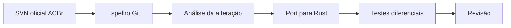

# ACBr Mirror & ACBr Rust

**Uma ponte entre o SVN do Projeto ACBr e um port experimental em Rust.**

Este repositório é uma iniciativa independente e **não oficial** da Kodexx. O [SVN do Projeto ACBr](https://svn.code.sf.net/p/acbr/code/trunk2) é a fonte de verdade para o código Pascal; os direitos dos componentes pertencem aos respectivos autores e colaboradores.

## Navegue pelo projeto

| Branch | Conteúdo | Como é atualizada |
| --- | --- | --- |
| [`main`](https://github.com/kodexx-pro/acbr/tree/main) | Apresentação e documentação do projeto. | Manualmente. |
| [`upstream/trunk2`](https://github.com/kodexx-pro/acbr/tree/upstream/trunk2) | Espelho do histórico e dos arquivos do `trunk2` oficial. | Automaticamente pela VPS, via `git-svn`. |
| [`rust`](https://github.com/kodexx-pro/acbr/tree/rust) | Código-fonte, testes e documentação do port experimental em Rust. | Por alterações de desenvolvimento, após verificação. |

As branches têm históricos independentes. O espelho cobre `trunk2`; não inclui automaticamente `tools` ou as outras branches e tags SVN. Não faça commits manuais nem force push em `upstream/trunk2`.

## Do SVN ao Rust



1. A VPS consulta o SVN oficial e converte as revisões relevantes em commits Git, preservando mensagens e metadados disponíveis. O rodapé `git-svn-id` identifica o caminho, UUID e número da revisão de origem.
2. O serviço publica os commits em `upstream/trunk2` sem reescrever seu histórico. Um bloqueio impede execuções simultâneas; falhas são registradas e a próxima execução tenta novamente.
3. Escolhemos uma funcionalidade delimitada, identificamos o arquivo, a revisão e os colaboradores da referência e implementamos o comportamento em Rust.
4. Testamos exemplos e casos de borda, inclusive comparando a execução Rust com a função Pascal correspondente quando o teste for viável. Divergências e limitações são documentadas.
5. Publicamos o código verificado na branch `rust`, com o aviso de autoria e a licença aplicável ao trecho portado.

**O espelhamento é automático. A análise, a portabilidade e a revisão ainda são manuais.** O fluxo de agentes descrito acima é a direção planejada, não um serviço já implantado. Uma revisão publicada no espelho não significa que ela já foi portada.

## O que já foi portado para Rust

| Crate | Escopo atual |
| --- | --- |
| [`acbr-dfe`](https://github.com/kodexx-pro/acbr/tree/rust/crates/acbr-dfe) | Validação de código de UF. |
| [`acbr-util`](https://github.com/kodexx-pro/acbr/tree/rust/crates/acbr-util) | Filtros e classificadores ASCII, padding, busca/remoção e manipulação de linhas; conversões ANSI por codepage e APIs `TStringList` seguem pendentes. |
| [`acbr-math`](https://github.com/kodexx-pro/acbr/tree/rust/crates/acbr-math) | Recorte de cálculo módulo 11. |
| [`acbr-validador`](https://github.com/kodexx-pro/acbr/tree/rust/crates/acbr-validador) | Os 17 tipos do componente, incluindo inscrição estadual por UF e e-mail; formatadores e calculador de dígitos. |

O ACBrValidador já oferece os 17 tipos, formatação, calculador e resultados detalhados com mensagem, documento, dígito calculado e callback. O CI executa testes e verifica formatação em Linux e Windows. A comparação diferencial com a unit Pascal foi executada em Linux ARM64. O port é experimental e não tem homologação fiscal. Consulte a [revisão detalhada](https://github.com/kodexx-pro/acbr/blob/rust/docs/ACBRVALIDADOR_REVIEW.md).

### Instalação e uso

```toml
[dependencies]
acbr-validador = { git = "https://github.com/kodexx-pro/acbr.git", branch = "rust" }
```

```rust
use acbr_validador::{validar_cpf, validar_cnpj, validar_gtin, validar_cep};

assert!(validar_cpf("529.982.247-25").is_ok());
assert!(validar_cnpj("11.222.333/0001-81").is_ok());
assert!(validar_gtin("7894900011517").is_ok());
assert!(validar_cep("88000-000", "SC").is_ok());
```

A API `Validador::validar_detalhado` expõe mensagem, documento e dígito; `validar_detalhado_com_evento` chama um callback e retorna `Result`. Veja os exemplos na [branch Rust](https://github.com/kodexx-pro/acbr/tree/rust).

Para builds reproduzíveis, fixe uma revisão Git com `rev` e mantenha seu `Cargo.lock`. As funções portadas usam as opções padrão do ACBr; diferenças e limitações estão detalhadas na [documentação da branch Rust](https://github.com/kodexx-pro/acbr/tree/rust).

### Testes

```bash
git clone --single-branch --branch rust https://github.com/kodexx-pro/acbr.git acbr-rust
cd acbr-rust
cargo test --workspace
```

O teste diferencial exige Python 3, Free Pascal e um clone do espelho com os commits listados em [`NOTICE.md`](https://github.com/kodexx-pro/acbr/blob/rust/NOTICE.md):

```bash
export ACBR_MIRROR_DIR=/caminho/para/o/clone-do-espelho
python3 scripts/verify_differential.py
python3 scripts/verify_util_differential.py
python3 scripts/verify_validador_differential.py
python3 scripts/verify_format_differential.py
python3 scripts/verify_calc_differential.py
```

Os testes individuais compilam trechos Pascal extraídos com adaptadores. A rotina `scripts/verify_full_component.sh` também compila a unit original inteira com suas dependências; na VPS foram comparadas 130.976 validações, 15.000 formatações, 12.000 cálculos e 20.210 resultados detalhados, incluindo mensagens, documento, dígito e callback. Veja os pré-requisitos e limites na [revisão](https://github.com/kodexx-pro/acbr/blob/rust/docs/ACBRVALIDADOR_REVIEW.md).

O código `91` retorna `false` no primeiro port de `ValidarCodigoUF`, acompanhando um detalhe da constante original; isso não afirma que seja a regra fiscal correta. CEP e prefixos usam as tabelas do ACBr na revisão fixada, sem consulta online.

## Acompanhe o espelho

O temporizador aguarda cerca de cinco minutos após cada execução para iniciar a próxima. Na VPS:

```bash
systemctl --user status acbr-mirror-sync.timer
journalctl --user -u acbr-mirror-sync.service -n 50 --no-pager
```

O diretório `.git` do clone `git-svn` e sua configuração precisam ser preservados e incluídos no backup. Alterações no ACBr devem ser propostas pelos canais oficiais do projeto.

## Origem, autoria e licença

A licença e os avisos originais são preservados no espelho. O arquivo usado no primeiro port declara **LGPL 2.1 ou posterior**; a branch `rust` inclui a licença, os créditos e o cabeçalho original em [`NOTICE.md`](https://github.com/kodexx-pro/acbr/blob/rust/NOTICE.md). Outros componentes e suas dependências devem ser analisados individualmente. Informações oficiais: [fontes do ACBr](https://projetoacbr.com.br/fontes/).
